

  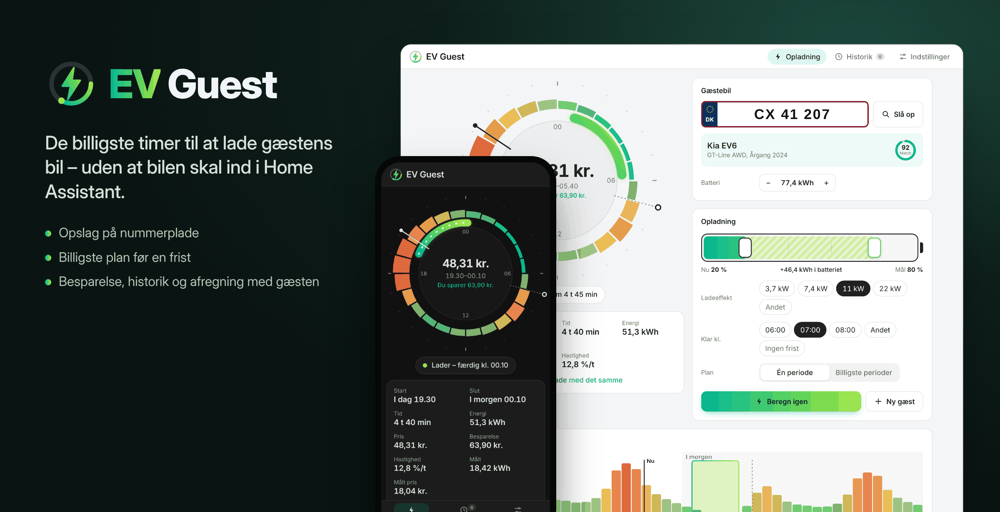

  
  
  
  
  
  
  

# EV Guest til Home Assistant

🇬🇧 [Read in English](README.md)

En gæst kommer i elbil og kører igen i morgen tidlig. EV Guest finder de billigste timer at lade den i ud fra dine elpriser – uden at bilen skal ind i Home Assistant. Skriv nummerpladen, hvor fuldt batteriet er, og hvornår bilen skal være klar. Så planlægger EV Guest opladningen, viser hvad den koster og hvad du sparer, og starter og pauser din lader præcis, når planen siger det – og giver den tilbage, når gæsten er kørt.

EV Guest er en beregner: den styrer aldrig selv en lader. En automation på to linjer eller [EV Smart Charging](https://github.com/jonasbkarlsson/ev_smart_charging) står for selve opladningen.

**Indhold:** [Funktioner](#funktioner) · [Krav](#krav) · [Installation](#installation) · [Opsætning](#opsætning) · [Panelet](#panelet) · [Entiteter](#entiteter) · [Handlinger](#handlinger) · [Opladning af bilen](#opladning-af-bilen) · [Sådan virker det](#sådan-virker-det) · [Prissensorer](#understøttede-prissensorer) · [Begrænsninger](#kendte-begrænsninger) · [Fejlfinding](#fejlfinding) · [Fjernelse](#fjern-integrationen) · [Privatliv](#privatliv)

## Funktioner

EV Guest tilføjer et **EV Guest-panel** i sidebaren. Det følger dit Home Assistant-tema i lys og mørk tilstand, taler dansk og engelsk og virker på computer, tablet og telefon – også som app på hjemmeskærmen. Der skal ingen custom cards til.

### Prisuret

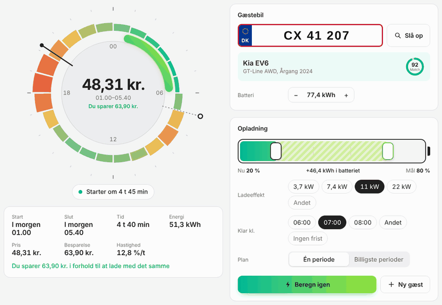

De næste 24 timers elpriser sidder rundt om et ur: billige timer i turkis, dyre i koral. Ladevinduet lyser op på uret, med en viser for nu og et flag for, hvornår bilen skal være klar. I midten: hvad opladningen koster, og hvad du sparer i forhold til at lade med det samme.

Træk i batteriet, skift ladeeffekt eller frist, og uret viser et **forslag** til den nye plan, mens du trækker. **Beregn plan** gemmer den.

### Gæstebilen ud fra nummerpladen

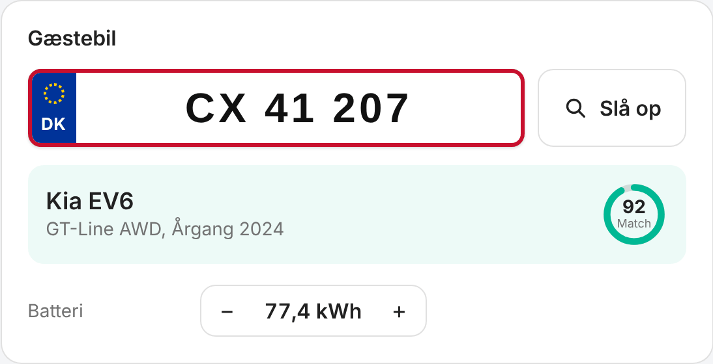

Skriv pladen på en dansk nummerplade og tryk **Slå op**. EV Guest finder bilen (MotorAPI), afkoder stelnummeret (NHTSA) og finder batteriets størrelse (Open EV Data). Ringen viser, hvor sikkert batteriet passer. Ingen nøgle, eller en sjælden bil? Sæt batteriet selv.

### Opladningen sat op på sekunder

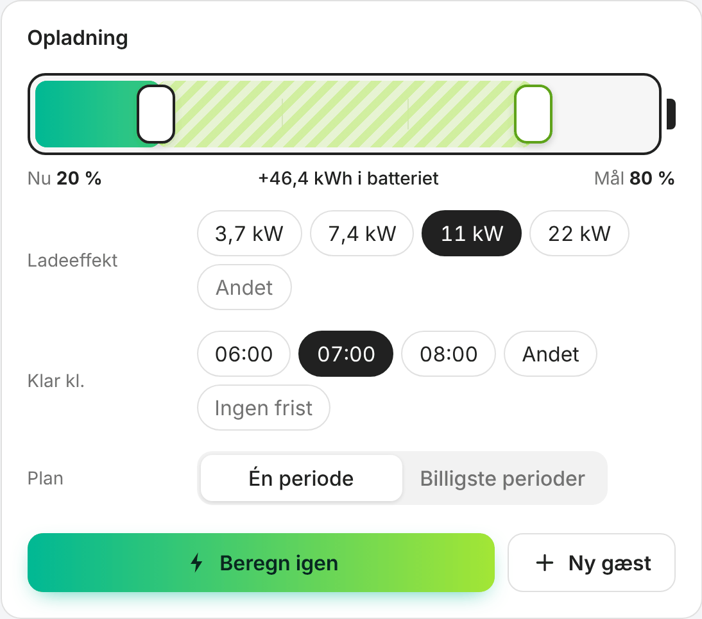

- Træk de to håndtag på batteriet: ladeniveauet **nu** og **målet**.
- Ladeeffekt: 3,7, 7,4, 11 eller 22 kW med ét tryk, eller en anden værdi.
- **Klar kl.** 06:00, 07:00, 08:00, et andet tidspunkt – eller ingen frist.
- **Én periode** eller de **billigste perioder**, delt op hvis det er billigere.

### Planen og de næste døgns priser

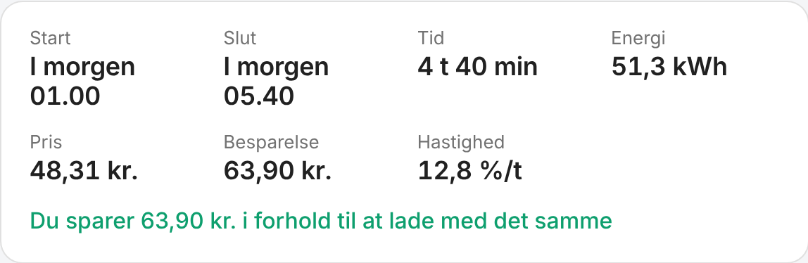

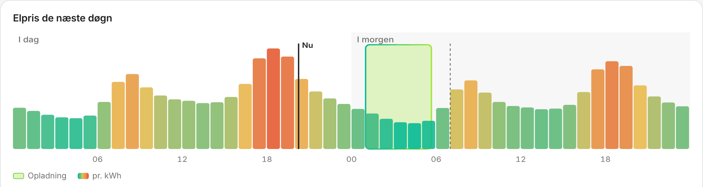

Start, slut, ladetid, energi fra nettet, pris og besparelse. Herunder dagens og morgendagens priser med ladeperioderne – rør ved grafen for at læse en pris. Mens bilen lader, fyldes batteriet, og uret viser strømmen løbe.

### Historik og afregning med gæsten

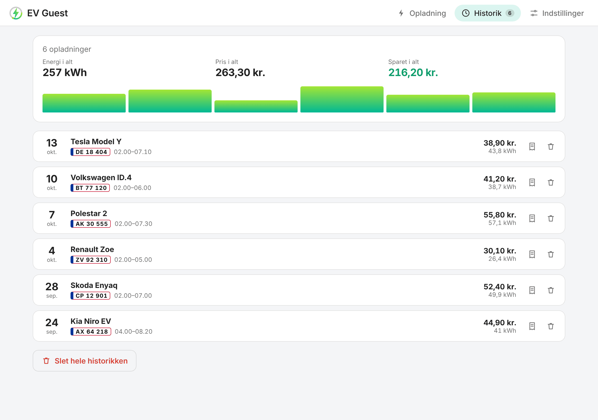

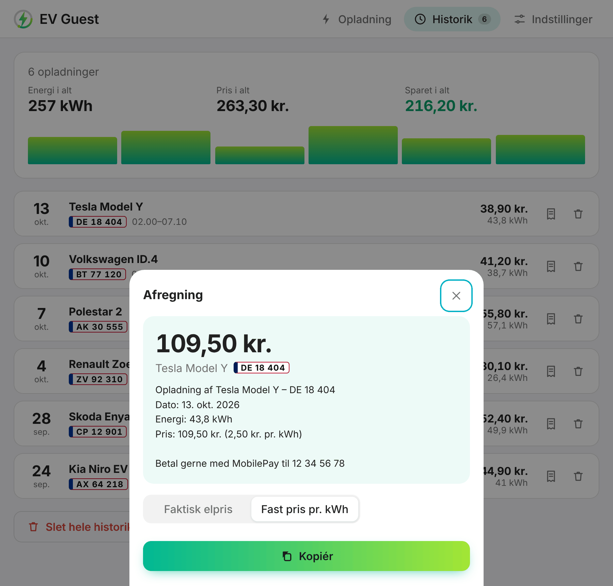

Hver afsluttet opladning gemmes, med samlet energi, pris og besparelse. **Afregn** laver en kort tekst til gæsten – efter den faktiske elpris eller din egen pris pr. kWh – med dine betalingsoplysninger. Kopiér den, eller del den fra telefonen.

### Målt, ikke kun planlagt

Vælg laderens elmåler i integrationens indstillinger, så måler EV Guest den energi og pris, der faktisk bruges, mens planen kører. Afregning og historik bruger så de målte tal.

Mens bilen lader, viser **Estimeret SoC**, hvor langt den er nået – ud fra planen, eller ud fra måleren hvis du har en. Med en måler tænder **Bagud ift. plan**, når bilen tager tydeligt mindre end planlagt, så du i tide ved, at den måske ikke når målet. Ingen måler? Alt andet virker på samme måde.

### Lyst og mørkt, computer og telefon

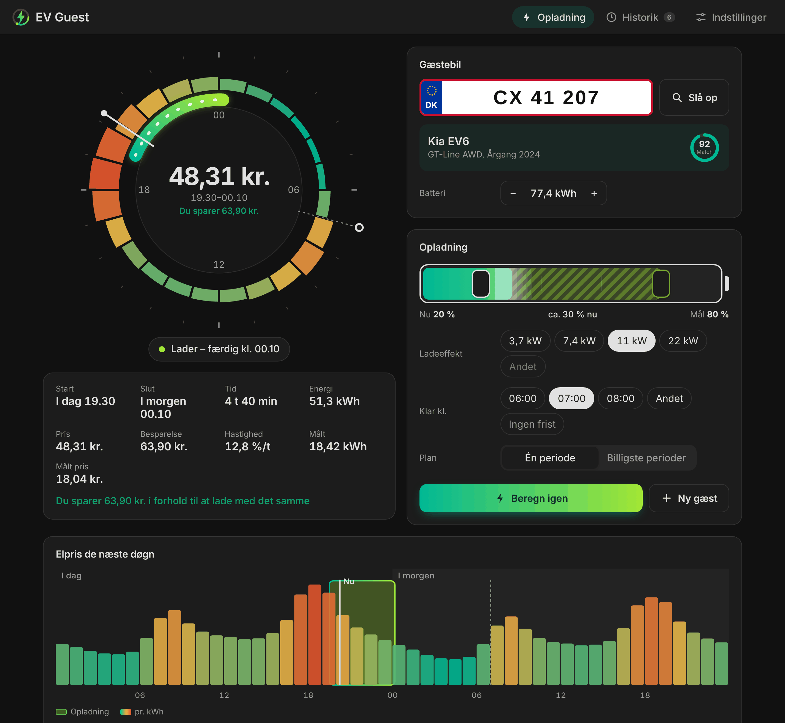

  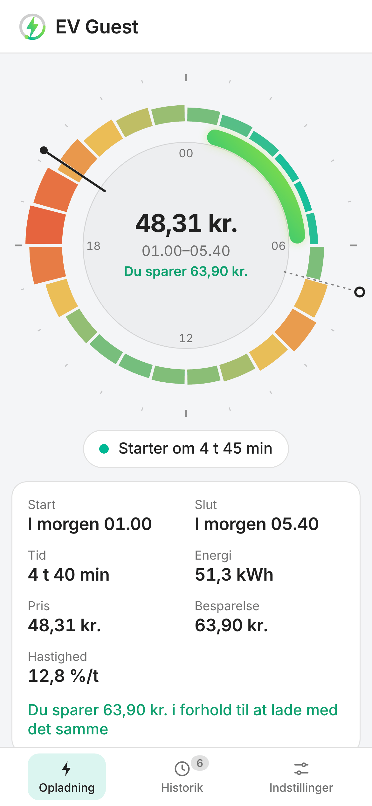
  &nbsp;
  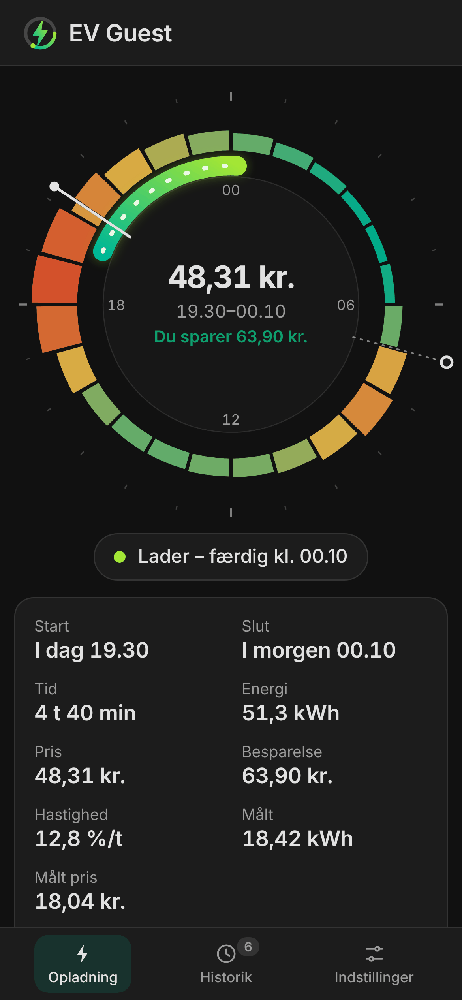

### App på hjemmeskærmen

Åbn `https://<dit-home-assistant>/ev_guest_app/app.html` på telefonen og vælg **Føj til hjemmeskærm**. EV Guest åbner i fuld skærm, logger ind med din Home Assistant-bruger og bruger dit tema. Linket står også under **Indstillinger** i panelet.

## Krav

- Home Assistant 2026.3 eller nyere.
- En sensor med elpriser for i dag og i morgen, fx **Energi Data Service** eller **Nord Pool** (se [prissensorer](#understøttede-prissensorer)).
- Valgfrit: en gratis [MotorAPI](https://www.motorapi.dk/)-nøgle til opslag på nummerplade.
- Valgfrit: en elmåler for laderen (kWh, samlet).

## Installation

### Med HACS (anbefalet)

1. Åbn linket ovenfor, eller tilføj `https://github.com/Dinnsen/EV-Guest` som custom repository i HACS (type **Integration**).
2. Hent **EV Guest** og genstart Home Assistant.

### Manuelt

1. Hent `ev_guest.zip` fra den [nyeste udgivelse](https://github.com/Dinnsen/EV-Guest/releases).
2. Pak den ud i `config/custom_components/ev_guest`.
3. Genstart Home Assistant.

## Opsætning

Tilføj **EV Guest** under **Indstillinger → Enheder og tjenester → Tilføj integration**.

| Indstilling | Beskrivelse |
| --- | --- |
| Navn | Enhedens navn, fx *EV Guest*. Hver EV Guest skal have sit eget navn. |
| Elprissensor | En sensor med priser for i dag og i morgen, pr. time eller pr. kvarter. Den tjekkes under opsætningen. |
| Land | Land for opslag på nummerplade. Indtil videre Danmark. |
| MotorAPI-nøgle | Valgfri, kun til opslag på nummerplade. Få en gratis nøgle på [motorapi.dk](https://www.motorapi.dk/): skriv din e-mail under *Få adgang nu*, så kommer nøglen på mail. |
| Valuta | Elprisernes valuta. Som udgangspunkt din Home Assistant-valuta. |

Bagefter:

- **Konfigurer** (indstillinger) ændrer valuta, **laderens elmåler** og **bil tilsluttet-sensoren** (laderens "bil tilsluttet"-sensor, der afslutter gæstesessionen, når bilen kobles fra). Begge er valgfri. Ændringer gælder med det samme.
- **Omkonfigurer** ændrer prissensor, land eller MotorAPI-nøgle.
- Holder MotorAPI-nøglen op med at virke, beder Home Assistant om en ny.

## Panelet

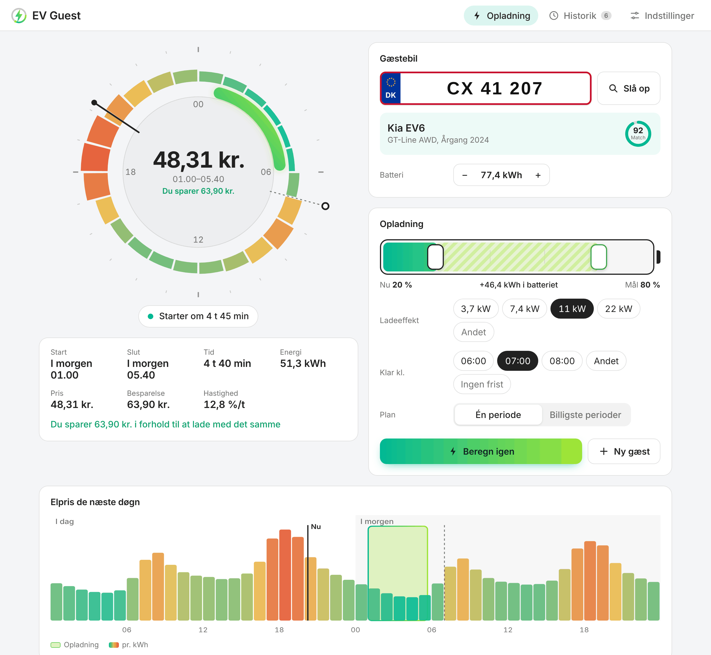

1. Skriv gæstens **nummerplade**, og tryk **Slå op**. Tjek bil og batteri.
2. Træk batteriet til ladeniveauet **nu** og **målet**, og vælg ladeeffekt og **Klar kl.**
3. Tryk **Beregn plan**. Status viser, hvornår opladningen starter.
4. Lad blueprintet starte og pause din lader efter planen (se [Opladning af bilen](#opladning-af-bilen)).
5. Når gæsten er kørt, tryk **Ny gæst**. Den afsluttede opladning ligger i **Historik**.

Flere EV Guests (fx to ladere)? Vælg mellem dem øverst i panelet.

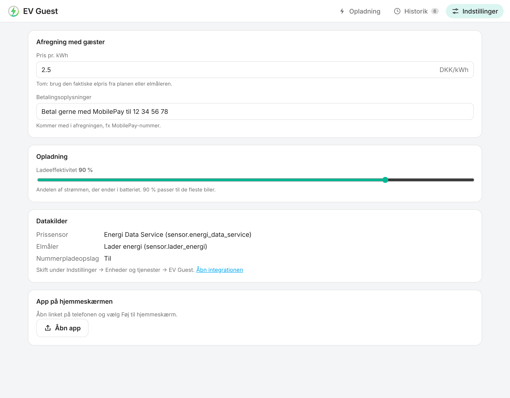

Under **Indstillinger** sætter du din pris pr. kWh og betalingsoplysninger til afregning, ladeeffektiviteten og ser datakilderne.

## Entiteter

Alt i panelet findes også som entiteter til automationer og dashboards. Entiteterne får danske navne i en dansk Home Assistant; entitets-id'erne er de samme som på engelsk.

| Entitet | Type | Beskrivelse |
| --- | --- | --- |
| Nummerplade | Tekst | Gæstebilens plade. |
| SoC (ladeniveau) | Tal (%) | Bilens ladeniveau nu. |
| Ladegrænse | Tal (%) | Ladeniveauet der skal nås. |
| Batterikapacitet | Tal (kWh) | Udfyldes af opslaget, eller sæt den selv. |
| Ladeeffekt | Tal (kW) | Hvad laderen trækker fra nettet. |
| Ladeeffektivitet | Tal (%) | Andelen af strømmen, der ender i batteriet. Standard 90 %. |
| Færdig ladet kl. | Tid | Hvornår bilen skal være ladet. |
| Brug færdig ladet kl. | Kontakt | Fra: planlæg frit inden for de næste 48 timers priser. |
| Foretræk sammenhængende opladning | Kontakt | Til: én periode. Fra: de billigste perioder, delt op hvis billigere. |
| Hent bildata | Knap | Slå bilen op ud fra pladen. |
| Beregn | Knap | Lav en ny plan. |
| Ny gæst | Knap | Ryd gæst og plan, klar til næste bil. |
| Ladestyring | Sensor (enum) | *Frigivet*, *Lad* eller *Pause*: hvad laderen skal gøre (se [Opladning af bilen](#opladning-af-bilen)). Attributter: `session_ends`, `released_at`, `release_reason`, `car_connected`. |
| Lad nu | Binær sensor | Tændt præcis mens planen siger lad. |
| Bagud ift. plan | Binær sensor (problem) | Kun med elmåler: tændt når laderen har leveret tydeligt mindre end planlagt (under 80 % og mindst 1 kWh for lidt, efter 20 minutters opladning). |
| Estimeret SoC | Sensor (%) | Gæstebilens estimerede ladeniveau: ud fra planen, eller ud fra elmåleren hvis der er valgt en. Attributter: `source` (`plan`/`meter`), `start_soc`, `target_soc`, `planned_soc`, `planned_energy`. |
| Status | Sensor (enum) | *Klar*, *Planlagt*, *Lader*, *Færdig*, eller hvorfor seneste beregning fejlede. |
| Ladestart / Ladeslut | Sensor (tidsstempel) | Start på første og slut på sidste ladeperiode. |
| Ladetid | Sensor (varighed) | Samlet ladetid. |
| Ladeomkostning | Sensor (beløb) | Forventet pris for planen. |
| Energibehov | Sensor (kWh) | Energi fra nettet inkl. ladetab. |
| Besparelse | Sensor (beløb) | I forhold til at lade med det samme. Attributter: `charge_now_cost`, `average_price`. |
| Målt energi / Målt pris | Sensor | Kun med elmåler: hvad planen faktisk brugte. |
| Ladehastighed | Sensor (%/t) | Ladeniveau pr. time, fx til EV Smart Charging. |
| Bilmærke / -model / -variant / batterikapacitet | Sensor (diagnostik) | Resultatet af opslaget. |

Statussensorens attributter (`charging_segments`, `charging_schedule`, `raw_two_days`, `plan_mode`, `plan_locked` m.fl.) er beskrevet i den [engelske README](README.md#status-attributes).

## Handlinger

| Handling | Beskrivelse |
| --- | --- |
| `ev_guest.grab_car_data` | Slå bilen op ud fra nummerpladen. |
| `ev_guest.calculate` | Lav en ny ladeplan. |
| `ev_guest.new_guest` | Ryd gæst og plan; en afsluttet plan gemmes i historikken. |

Alle tager et valgfrit `config_entry_id`, som kan udelades, når du har én EV Guest. Fejler en handling, viser Home Assistant hvorfor, fx *Skriv en nummerplade først*.

## Opladning af bilen

EV Guest planlægger; din lader står for opladningen. **Ladestyring** (`sensor.ev_guest_charger_control`) fortæller laderen, hvad den skal gøre:

| Tilstand | Betydning |
| --- | --- |
| `released` (Frigivet) | Ingen gæst. Lad laderen være – den er din. |
| `charge` (Lad) | Gæst, i en ladeperiode: lad laderen lade. |
| `pause` (Pause) | Gæst, uden for en ladeperiode: sæt laderen på pause. |

En **gæstesession** starter, når du laver en plan, og slutter altid af sig selv, så EV Guest aldrig holder på laderen, fordi den tror, der stadig er en gæst:

- når planen slutter,
- når du trykker **Ny gæst**, eller en ny beregning fejler,
- når bilen har været koblet fra i et minut (med en **bil tilsluttet-sensor**, se [Opsætning](#opsætning)).

Med en bil tilsluttet-sensor holdes en gæstebil, der stadig sidder i efter planen, på pause, til den kobles fra – højst 24 timer – så den ikke lader videre til fuld pris. Uden sensoren frigives laderen, når planen slutter.

### Med blueprintet (anbefalet)

Blueprintet *EV Guest – charger follows the plan* virker med enhver lader: du vælger, hvad der starter og sætter opladningen på pause.

| Lader | Start opladning | Pause opladning |
| --- | --- | --- |
| Zaptec ([HACS](https://github.com/custom-components/zaptec)) | Tænd kontakten *Charging* | Sluk kontakten *Charging* |
| Monta ([hass-monta](https://github.com/nickknissen/hass-monta)) | `monta.start_charging` med dit ladepunkt | `monta.stop_charging` med dit ladepunkt |
| Wallbox, Easee og andre med en kontakt | Tænd kontakten | Sluk kontakten |
| OCPP ([HACS](https://github.com/lbbrhzn/ocpp)) | Sæt *Maximum current* til din normale strøm | Sæt *Maximum current* til 0 A |
| Tesla Wall Connector | – | – (kan ikke styres fra Home Assistant) |

Blueprintet:

- lader og pauser med planen, og pauser igen, når en bil sættes i uden for en ladeperiode (de fleste ladere starter selv),
- giver laderen tilbage (kører *Start opladning*), når gæstesessionen slutter – kun efter at have holdt på den, aldrig af sig selv,
- indhenter efter en genstart af Home Assistant: følger en igangværende session, eller giver laderen tilbage, hvis sessionen sluttede, mens Home Assistant var nede.

### Med din egen automation

Følg `sensor.ev_guest_charger_control`: start opladning ved `charge`, pause ved `pause`, og giv kun laderen tilbage, når den skifter fra `charge` eller `pause` til `released`. `binary_sensor.ev_guest_charge_now` viser stadig de planlagte perioder, men styr ikke en lader på den alene: den er også slukket, når der ikke er nogen gæst.

### Med EV Smart Charging

[EV Smart Charging](https://github.com/jonasbkarlsson/ev_smart_charging) tager enhver entitet med en værdi fra 0 til 100 som SoC, så en EV Smart Charging-opsætning til gæstebiler kan læse direkte fra EV Guest:

- **EV SOC entity**: `number.ev_guest_soc_state_of_charge`
- **EV target SOC entity**: `number.ev_guest_charge_limit`
- **Charger control entity**: din laders kontakt (en gæstebil er ikke i Home Assistant)

Ladehastighed og frist er indstillinger i EV Smart Charging. Kopiér dem med en automation: `sensor.ev_guest_charging_speed` (%/t) → `number.ev_smart_charging_charging_speed`, og fristen (hele timer) → `select.ev_smart_charging_charge_completion_time`. EV Smart Charging laver så sin egen plan; EV Guests plan er et forslag.

## Sådan virker det

- **Energi og tid.** Energi i batteriet = kapacitet × (mål − nu). Fra nettet divideres med ladeeffektiviteten (standard 90 %), og ladetiden er energien fra nettet divideret med ladeeffekten.
- **Den billigste plan.** EV Guest prøver alle perioder, der kan nå at blive færdige før fristen – også én, der starter i den prisperiode, der kører nu, og én, der slutter præcis ved et prisskift – og beholder den billigste. Med *billigste perioder* bruges de billigste prisperioder, og en rest lægges op ad en af dem, så opladningen ikke deles mere op end nødvendigt.
- **Besparelsen** sammenligner planen med at lade den samme energi fra nu af.
- **Estimeret ladeniveau.** EV Guest ser aldrig bilen. Uden måler er estimatet planens startniveau plus den ladetid, der er gået × ladeeffekt × effektivitet, aldrig over målet. Med måler er det startniveauet plus den målte energi × effektivitet. Det opdateres hvert minut, mens bilen lader.
- **Planer der opfører sig.** En plan følger nye priser (fx når morgendagens priser kommer), indtil den starter. Når den er startet, låses den: EV Guest ser aldrig bilens aktuelle ladeniveau, og en plan der flyttede sig under opladningen, ville lade to gange. Tryk **Beregn plan** for at planlægge igen.
- **Ingen polling.** EV Guest opdaterer, når du ændrer noget, når prissensoren ændrer sig, og præcis når en ladeperiode starter eller slutter. Opslaget kontakter kun MotorAPI, NHTSA og Open EV Data, når du trykker **Slå op**; listen fra Open EV Data hentes højst én gang i døgnet.
- **Historik.** En plan gemmes i historikken ti minutter efter den slutter (så sene målinger kommer med), eller med det samme når du trykker **Ny gæst** eller planlægger en ny bil. Planer, du erstatter før de er færdige, gemmes ikke.
- **Måling.** Med en elmåler lægges hver stigning på måleren fra planens start til ti minutter efter dens slut sammen, til elprisen på det tidspunkt. En nulstilling af måleren eller et spring på over 100 kWh ignoreres.
- **Overlever genstart.** Input, plan, historik og indstillinger gemmes og overlever genstart og opdateringer.

## Understøttede prissensorer

Enhver sensor med priser for i dag og i morgen – pr. time, pr. halve time eller pr. kvarter – i et af disse formater:

- `raw_today` / `raw_tomorrow` (og `forecast`) med `hour` og `price` – **Energi Data Service**
- `raw_today` / `raw_tomorrow` med `start`, `end` og `value` – **Nord Pool** fra HACS
- `today` / `tomorrow` som lister med priser fra midnat

Brug en sensor med de priser, du faktisk betaler (med nettarif og afgifter), for at få den rigtige pris.

## Kendte begrænsninger

- Opslag på nummerplade virker kun i Danmark. Uden det sætter du batterikapaciteten selv.
- Batteriet fra Open EV Data er et bedste gæt; tjek det, især for sjældne varianter.
- Opladningen regnes med fuld effekt hele tiden; rigtige biler lader langsommere tæt på fuldt. Et mål på 80–90 % holder planen tæt på virkeligheden.
- Kobles gæstens bil fra, og en anden bil sættes i inden for et minut, tror EV Guest, det er den samme bil. Tryk **Ny gæst** for at frigive laderen.
- EV Guest ser ikke bilens aktuelle ladeniveau. *Estimeret SoC* er et estimat ud fra planen eller måleren.
- Nogle ladere opdaterer kun deres elmåler en gang imellem. *Bagud ift. plan* kan så være tændt et stykke tid indtil næste aflæsning.
- Home Assistants egen Nord Pool-integration har ingen pris-attributter; brug Nord Pool fra HACS eller Energi Data Service.
- Elmåleren måler alt på måleren, mens planen kører – også en anden bil på samme lader.

## Fejlfinding

| Problem | Det kan du gøre |
| --- | --- |
| *Sensoren har ingen priser, som EV Guest kan læse* under opsætningen | Vælg selve prissensoren, ikke en skabelon med kun den aktuelle pris. Den skal have `raw_today`- eller `today`-attributter. |
| Status *Venter på priser* | Der kendes endnu ikke priser nok før fristen. EV Guest planlægger selv, når de kommer (typisk efter kl. 13). |
| Status *Intet ladevindue* | Opladningen kan ikke nå at blive færdig før fristen. Hæv ladeeffekten, sænk målet eller flyt fristen. |
| Panelet er ikke i sidebaren | Genstart Home Assistant efter installationen, og genindlæs browseren. |
| En reparation siger, at prissensoren mangler | Brug **Omkonfigurer** på EV Guest og vælg en anden sensor. |
| *Slå op* kræver en MotorAPI-nøgle | Tilføj en nøgle under **Omkonfigurer**, eller sæt batterikapaciteten selv. |
| Bilsensorerne er utilgængelige | Seneste opslag kunne ikke nå MotorAPI. Prøv igen senere. |

Vedhæft diagnostik til fejlrapporter (**Indstillinger → Enheder og tjenester → EV Guest → ⋮ → Download diagnostik**). Nummerplader, stelnummer og API-nøgle fjernes automatisk.

## Fjern integrationen

1. Gå til **Indstillinger → Enheder og tjenester → EV Guest**, åbn menuen og vælg **Slet**. Gemte input, planer og historik slettes også, og panelet forsvinder med den sidste EV Guest.
2. Fjern eventuelt EV Guest i HACS og genstart Home Assistant.

## Privatliv

EV Guest kører i din Home Assistant. Når du trykker **Slå op**, sendes nummerpladen til MotorAPI, stelnummeret til NHTSA, og bilens mærke og model findes i Open EV Datas offentlige liste. Historikken, med nummerplader, gemmes kun i din Home Assistant; slet enkelte opladninger i panelet eller det hele med **Slet hele historikken**. Diagnostik indeholder aldrig nummerplader, stelnummer eller API-nøgle.

EV Guest er ikke tilknyttet, godkendt eller vedligeholdt af Home Assistant, MotorAPI, NHTSA eller Open EV Data. Du er selv ansvarlig for din API-nøgle og din brug af tjenesterne.

## Support

Fundet en fejl eller har en idé? [Opret et issue](https://github.com/Dinnsen/EV-Guest/issues/new/choose). Vil du have EV Guest i dit land eller på dit sprog? Der er skabeloner til det også, og [CONTRIBUTING.md](CONTRIBUTING.md) viser, hvordan du selv tilføjer dem. Sparer EV Guest dig penge, er du velkommen til at [give en kop kaffe](https://buymeacoffee.com/dinnsen) ☕

## Licens

[MIT](LICENSE). Hjemmeskærm-appen indeholder [home-assistant-js-websocket](https://github.com/home-assistant/home-assistant-js-websocket) (Apache 2.0).
