<p align="center">
  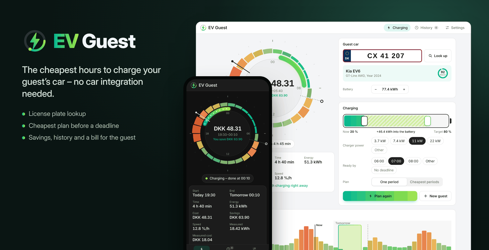
</p>

<p align="center">
  <a href="https://github.com/Dinnsen/EV-Guest/releases"></a>
  <a href="https://hacs.xyz"></a>
  
  
  <a href="https://github.com/Dinnsen/EV-Guest/actions/workflows/tests.yml"></a>
  <a href="LICENSE"></a>
  <a href="https://buymeacoffee.com/dinnsen"></a>
</p>

# EV Guest for Home Assistant

🇩🇰 [Læs på dansk](README.da.md)

A guest arrives with an electric car and leaves in the morning. EV Guest finds the cheapest hours to charge it from your electricity prices – without adding the car to Home Assistant. Enter the license plate, say how full the battery is and when the car must be ready, and EV Guest plans the charging, shows what it costs and what you save, and starts and pauses your charger exactly when the plan says – then hands it back when the guest has gone.

EV Guest is a calculator: it never switches a charger itself. A two-line automation or [EV Smart Charging](https://github.com/jonasbkarlsson/ev_smart_charging) does the charging.

**Contents:** [Features](#features) · [Requirements](#requirements) · [Installation](#installation) · [Setup](#setup) · [The panel](#the-panel) · [Entities](#entities) · [Actions](#actions) · [Charging the car](#charging-the-car) · [How it works](#how-it-works) · [Supported price sensors](#supported-price-sensors) · [Limitations](#known-limitations) · [Troubleshooting](#troubleshooting) · [Removal](#removing-the-integration) · [Privacy](#privacy)

## Features

EV Guest adds an **EV Guest panel** to the sidebar. It follows your Home Assistant theme in light and dark mode, speaks English and Danish, and works on a computer, a tablet and a phone – also as an app on the home screen. No custom cards needed.

### The price clock

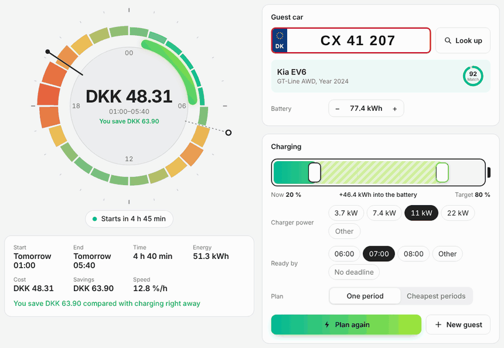

The next 24 hours of electricity prices sit around a clock: cheap hours in teal, expensive ones in coral. The charging window is lit up on the clock, with a needle for now and a flag for when the car must be ready. In the middle: what the charge costs and what you save compared with charging right away.

Drag the battery, change the charger power or the deadline, and the clock shows a **preview** of the new plan while you drag. **Make plan** stores it.

### The guest car from its license plate

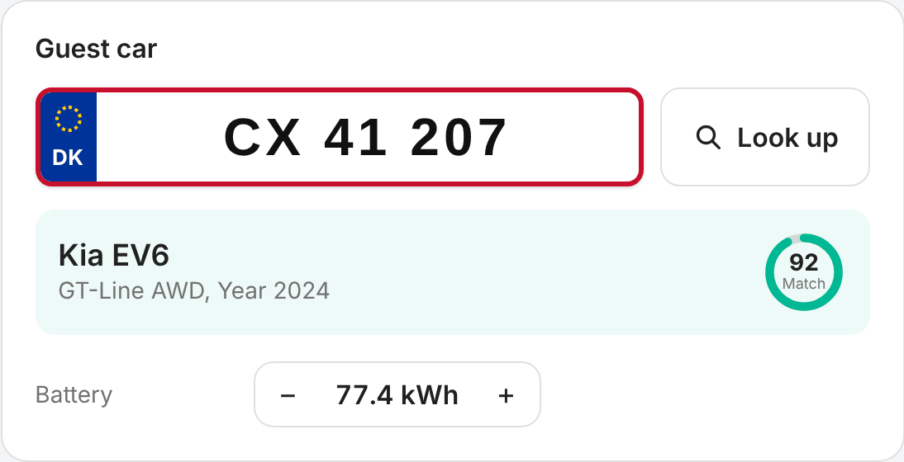

Type the plate on a Danish number plate and tap **Look up**. EV Guest finds the car (MotorAPI), decodes the VIN (NHTSA) and matches the battery capacity (Open EV Data). The ring shows how sure the battery match is. No key, or an unusual car? Set the battery yourself.

### Charging, set in seconds

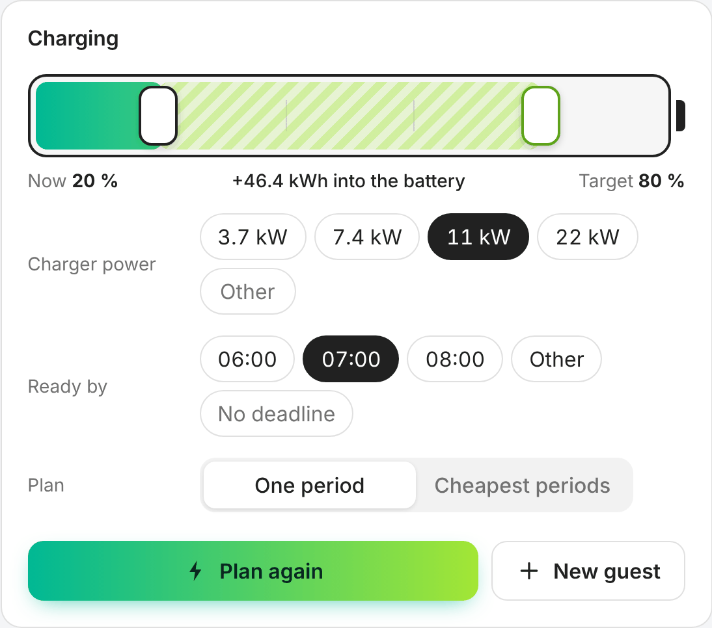

- Drag the two handles on the battery: the charge level **now** and the **target**.
- Charger power: 3.7, 7.4, 11 or 22 kW with one tap, or any other value.
- **Ready by** 06:00, 07:00, 08:00, another time – or no deadline.
- **One period** or the **cheapest periods**, split if that is cheaper.

### The plan and the next days' prices

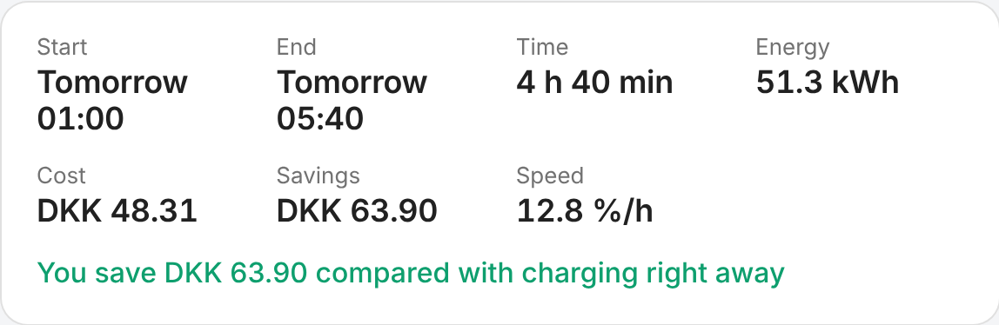

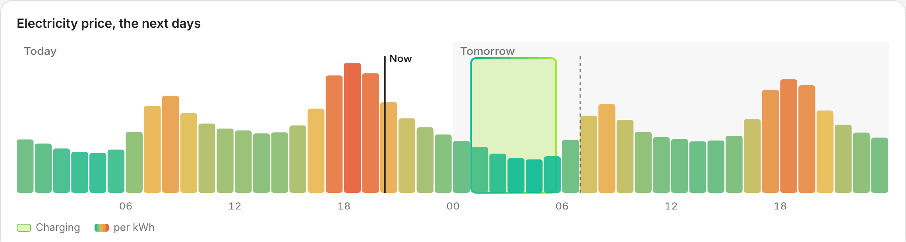

Start, end, charging time, energy from the grid, cost and savings. Below, today's and tomorrow's prices with the charging periods – touch the graph to read a price. While the car charges, the battery fills and the clock shows the energy flowing.

### History and a bill for the guest

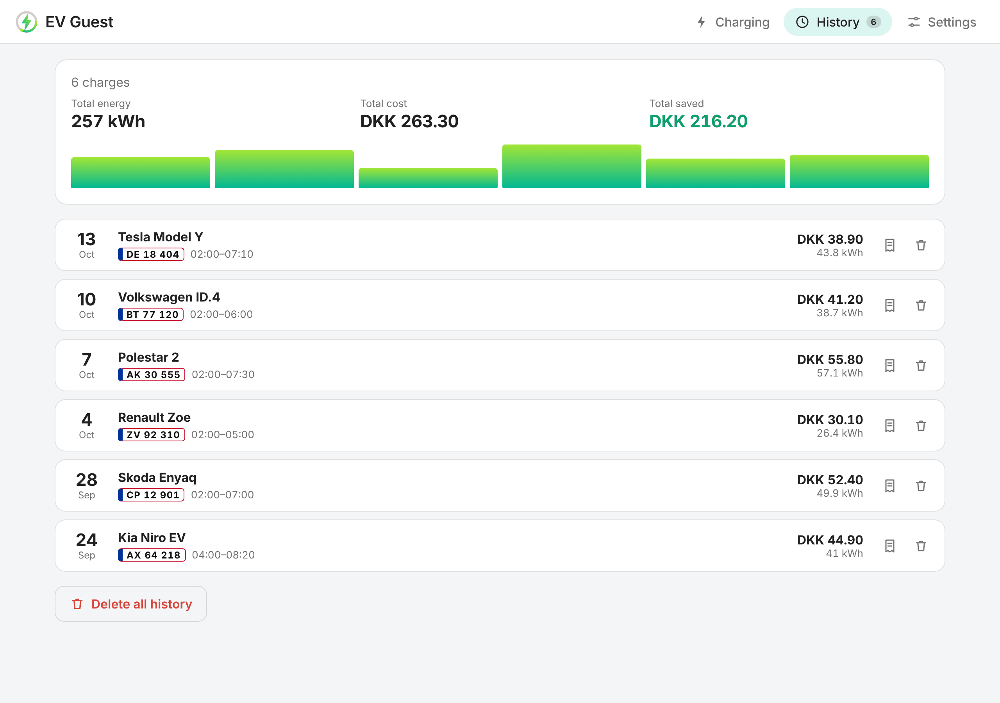

<p align="center">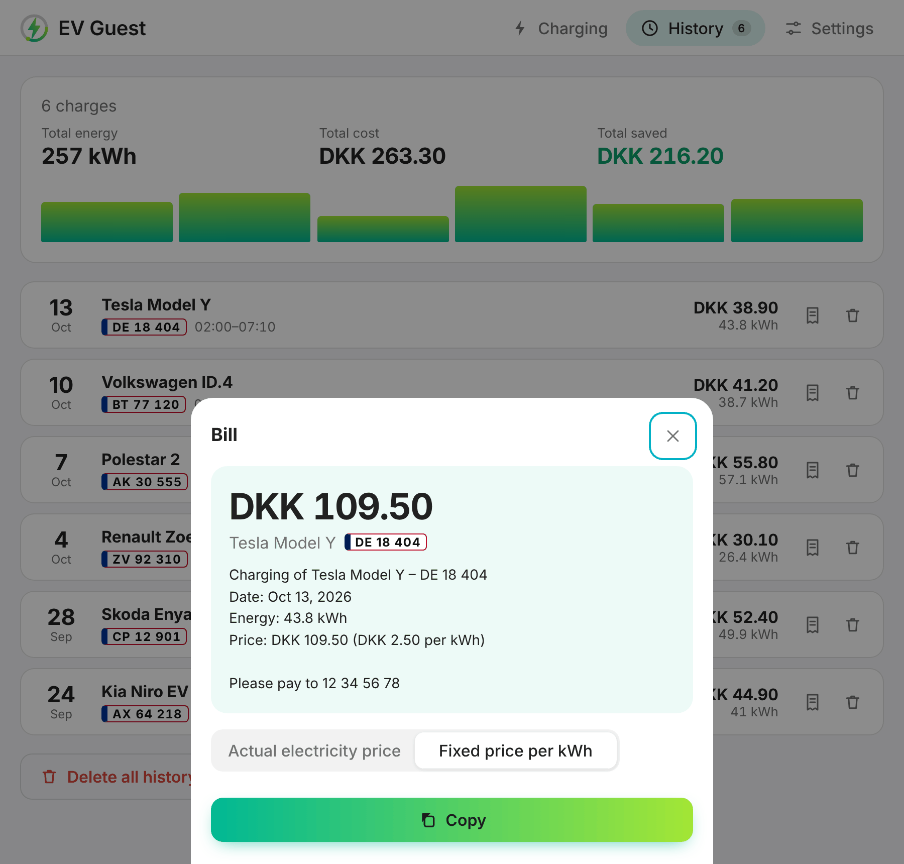</p>

Every finished charge is kept, with totals for energy, cost and savings. **Bill** makes a short text for the guest – by the actual electricity price, or by your own price per kWh – with your payment details. Copy it, or share it from your phone.

### Measured, not only planned

Pick your charger's energy meter in the integration options, and EV Guest measures the energy and cost actually used while the plan runs. The bill and the history then use the measured figures.

While the car charges, **Estimated SoC** shows how far it has come – from the plan, or from the meter when you have one. With a meter, **Behind plan** turns on when the car takes clearly less than planned, so you know in time that it may not reach the target. No meter? Everything else works the same.

### Light and dark, desktop and phone

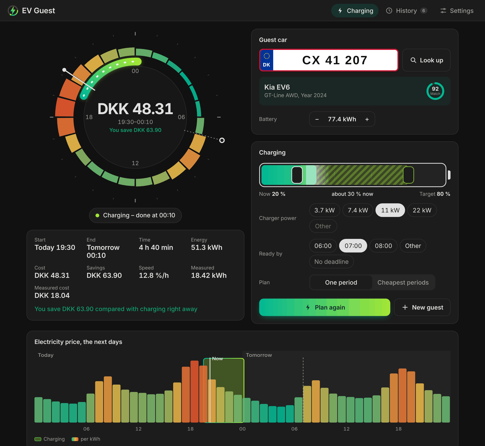

<p align="center">
  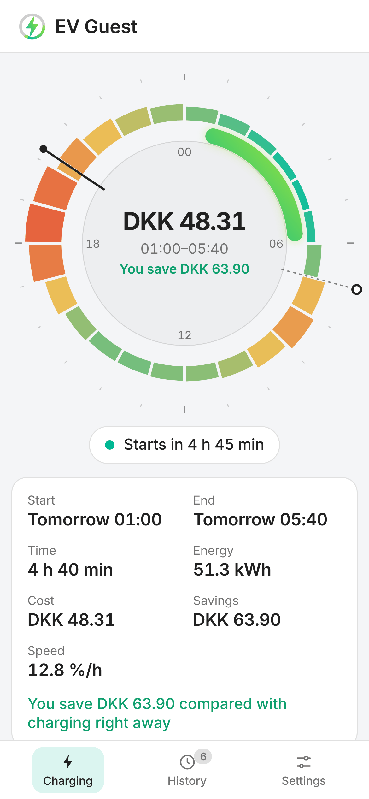
  &nbsp;
  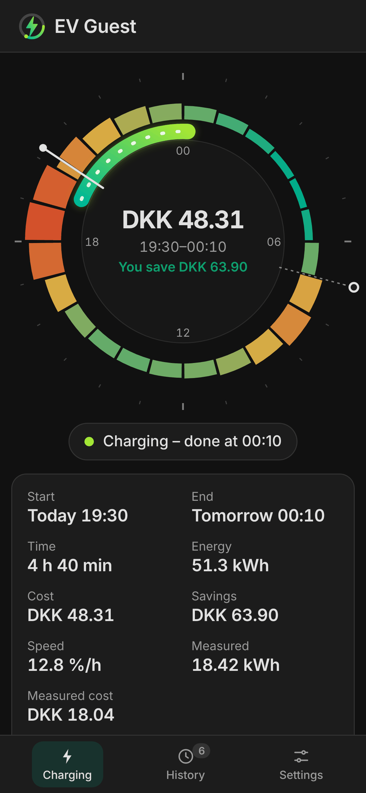
</p>

### App on the home screen

Open `https://<your-home-assistant>/ev_guest_app/app.html` on your phone and choose **Add to Home Screen**. EV Guest opens full screen, signs in with your Home Assistant user and uses your theme. The link is also under **Settings** in the panel.

## Requirements

- Home Assistant 2026.3 or newer.
- A sensor with electricity prices for today and tomorrow, e.g. **Energi Data Service** or **Nord Pool** (see [supported price sensors](#supported-price-sensors)).
- Optional: a free [MotorAPI](https://www.motorapi.dk/) key for license plate lookup (Denmark).
- Optional: an energy meter for the charger (kWh, total).

## Installation

### With HACS (recommended)

[](https://my.home-assistant.io/redirect/hacs_repository/?owner=Dinnsen&repository=EV-Guest&category=integration)

1. Open the link above, or add `https://github.com/Dinnsen/EV-Guest` as a custom repository in HACS (type **Integration**).
2. Download **EV Guest** and restart Home Assistant.

### Manually

1. Download `ev_guest.zip` from the [latest release](https://github.com/Dinnsen/EV-Guest/releases).
2. Unzip it into `config/custom_components/ev_guest`.
3. Restart Home Assistant.

## Setup

[](https://my.home-assistant.io/redirect/config_flow_start/?domain=ev_guest)

Add **EV Guest** under **Settings → Devices & services → Add integration**.

| Setting | Description |
| --- | --- |
| Name | Device name, e.g. *EV Guest*. Each EV Guest needs its own name. |
| Electricity price sensor | A sensor with prices for today and tomorrow, hourly or every 15 minutes. It is checked during setup. |
| Country | Country for license plate lookup. Currently Denmark. |
| MotorAPI API key | Optional, only for license plate lookup. Get a free key at [motorapi.dk](https://www.motorapi.dk/): enter your email under *Få adgang nu* and the key arrives by email. |
| Currency | Currency of the electricity prices. Defaults to your Home Assistant currency. |

Afterwards:

- **Configure** (options) changes the currency, the **charger energy meter** and the **car connected sensor** (the charger's "car connected" binary sensor, which ends the guest session when the car is unplugged). Both are optional. Changes apply right away.
- **Reconfigure** changes the price sensor, country or MotorAPI key.
- If the MotorAPI key stops working, Home Assistant asks you for a new one.

## The panel

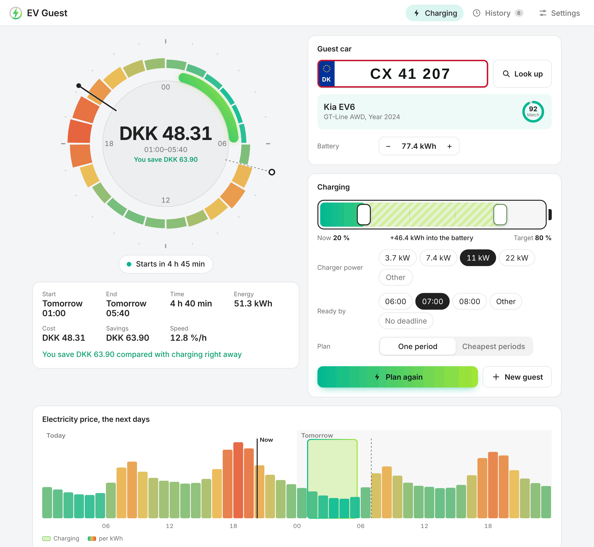

1. Enter the guest's **license plate** and tap **Look up**. Check the car and the battery.
2. Drag the battery to the charge level **now** and the **target**, and choose the charger power and **Ready by**.
3. Tap **Make plan**. The status shows when charging starts.
4. Let the blueprint start and pause your charger with the plan (see [Charging the car](#charging-the-car)).
5. When the guest has left, tap **New guest**. The finished charge is in **History**.

Several EV Guests (e.g. two chargers)? Choose between them at the top of the panel.

What do the bars and arcs on the clock mean? Tap **?** at the top right: it explains every part of the price clock and what each part of the panel does.

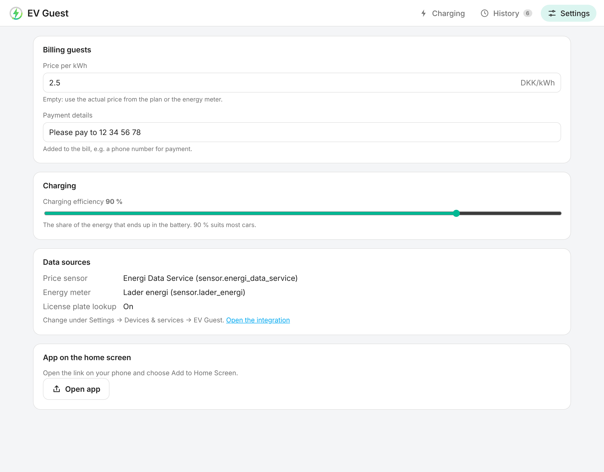

**Settings** holds your price per kWh and payment details for bills, the charging efficiency and an overview of the data sources.

## Entities

Everything in the panel is also available as entities, for automations and dashboards.

| Entity | Type | Description |
| --- | --- | --- |
| License plate | Text | The guest car's plate. |
| SoC (State of Charge) | Number (%) | The car's charge level now. |
| Charge limit | Number (%) | The charge level to reach. |
| Battery capacity | Number (kWh) | Filled in by the lookup, or set it yourself. |
| Charger power | Number (kW) | What the charger draws from the grid. |
| Charging efficiency | Number (%) | Share of the energy that ends up in the battery. Default 90 %. |
| Charge completion time | Time | When the car must be charged. |
| Use charge completion time | Switch | Off: plan freely within the next 48 hours of prices. |
| Continuous charging preferred | Switch | On: one period. Off: the cheapest periods, split if cheaper. |
| Grab car data | Button | Look up the car from the plate. |
| Calculate | Button | Make a new plan. |
| New guest | Button | Clear the guest and the plan, ready for the next car. |
| Charger control | Sensor (enum) | *Released*, *Charge* or *Pause*: what the charger should do (see [Charging the car](#charging-the-car)). Attributes: `session_ends`, `released_at`, `release_reason`, `car_connected`. |
| Charge now | Binary sensor | On exactly while the plan says charge. |
| Behind plan | Binary sensor (problem) | Only with an energy meter: on when the charger has delivered clearly less than planned (below 80 % and at least 1 kWh short, after 20 minutes of charging). |
| Estimated SoC | Sensor (%) | The guest car's estimated charge level: from the plan, or from the energy meter when one is set. Attributes: `source` (`plan`/`meter`), `start_soc`, `target_soc`, `planned_soc`, `planned_energy`. |
| Status | Sensor (enum) | *Ready*, *Planned*, *Charging*, *Completed*, or why the last calculation failed. |
| Charge start time / Charge end time | Sensor (timestamp) | Start of the first and end of the last charging period. |
| Charge time | Sensor (duration) | Total charging time. |
| Charge costs | Sensor (monetary) | Expected cost of the plan. |
| Energy needed | Sensor (kWh) | Energy from the grid, including charging losses. |
| Savings | Sensor (monetary) | Compared with charging right away. Attributes: `charge_now_cost`, `average_price`. |
| Measured energy / Measured cost | Sensor | Only with an energy meter: what the plan actually used. |
| Charging speed | Sensor (%/h) | Charge level gained per hour, e.g. for EV Smart Charging. |
| Car brand / model / variant / battery capacity | Sensor (diagnostic) | Result of the lookup. |

### Status attributes

| Attribute | Description |
| --- | --- |
| `charging_segments` | The exact planned periods as `start`/`end`. |
| `charging_schedule` | The plan per price period (1 = charging), aligned with `raw_two_days`, for graphs. |
| `raw_two_days` | Today's and tomorrow's prices, for graphs. |
| `plan_mode` | `continuous` or `split`. |
| `plan_locked` | `true` once the plan has started. |
| `last_calculation`, `last_lookup`, `vin`, `model_year`, `fuel_type`, `match_score` | Details of the last calculation and lookup. |

## Actions

| Action | Description |
| --- | --- |
| `ev_guest.grab_car_data` | Look up the car from the license plate. |
| `ev_guest.calculate` | Make a new charging plan. |
| `ev_guest.new_guest` | Clear the guest and the plan; a finished plan is kept in the history. |

All take an optional `config_entry_id`, which can be left out when you have one EV Guest. When an action fails, Home Assistant shows why, e.g. *Enter a license plate first*.

```yaml
action: ev_guest.calculate
```

## Charging the car

EV Guest plans; your charger does the charging. **Charger control** (`sensor.ev_guest_charger_control`) tells the charger what to do:

| State | Meaning |
| --- | --- |
| `released` | No guest. Leave the charger alone – it is yours. |
| `charge` | Guest, inside a charging period: let the charger charge. |
| `pause` | Guest, outside a charging period: pause the charger. |

A **guest session** starts when you make a plan and always ends by itself, so EV Guest never holds the charger because it thinks a guest is still there:

- when the plan ends,
- when you tap **New guest**, or a new calculation fails,
- when the car has been unplugged for a minute (with a **car connected sensor**, see [Setup](#setup)).

With a car connected sensor, a guest car that is still plugged in after the plan stays paused until it is unplugged – at most 24 hours – so it does not charge on at full price. Without one, the charger is released when the plan ends.

### With the blueprint (recommended)

[](https://my.home-assistant.io/redirect/blueprint_import/?blueprint_url=https%3A%2F%2Fgithub.com%2FDinnsen%2FEV-Guest%2Fblob%2Fmain%2Fblueprints%2Fautomation%2Fev_guest%2Fcharger_follows_ev_guest.yaml)

The blueprint *EV Guest – charger follows the plan* works with any charger: you choose what starts and what pauses charging.

| Charger | Start charging | Pause charging |
| --- | --- | --- |
| Zaptec ([HACS](https://github.com/custom-components/zaptec)) | Turn on the *Charging* switch | Turn off the *Charging* switch |
| Monta ([hass-monta](https://github.com/nickknissen/hass-monta)) | `monta.start_charging` with your charge point | `monta.stop_charging` with your charge point |
| Wallbox, Easee and others with a switch | Turn on the switch | Turn off the switch |
| OCPP ([HACS](https://github.com/lbbrhzn/ocpp)) | Set *Maximum current* to your normal current | Set *Maximum current* to 0 A |
| Tesla Wall Connector | – | – (it cannot be controlled from Home Assistant) |

The blueprint:

- charges and pauses with the plan, and pauses again when a car is plugged in outside a charging period (most chargers start by themselves),
- hands the charger back (runs *Start charging*) when the guest session ends – only after it has held the charger, never on its own,
- catches up after a Home Assistant restart: it follows a running session, or hands back a charger whose session ended while Home Assistant was down.

### With your own automation

Follow `sensor.ev_guest_charger_control`: start charging on `charge`, pause on `pause`, and hand the charger back only when it changes from `charge` or `pause` to `released`. `binary_sensor.ev_guest_charge_now` still shows the planned periods, but don't switch a charger on it alone: it is also off when there is no guest.

### With EV Smart Charging

[EV Smart Charging](https://github.com/jonasbkarlsson/ev_smart_charging) accepts any entity with a value from 0 to 100 as SoC, so an EV Smart Charging entry for guest cars can read EV Guest directly:

- **EV SOC entity**: `number.ev_guest_soc_state_of_charge`
- **EV target SOC entity**: `number.ev_guest_charge_limit`
- **Charger control entity**: your charger's switch (a guest car is not in Home Assistant)

Charging speed and completion time are settings inside EV Smart Charging. Copy them with an automation: `sensor.ev_guest_charging_speed` (%/h) → `number.ev_smart_charging_charging_speed`, and the completion time (whole hours) → `select.ev_smart_charging_charge_completion_time`. EV Smart Charging then makes its own plan; EV Guest's plan is a preview.

## How it works

- **Energy and time.** Energy into the battery = capacity × (target − now). From the grid that is divided by the charging efficiency (default 90 %), and the charging time is the grid energy divided by the charger power.
- **The cheapest plan.** EV Guest tries every period that fits before the deadline – also one that starts in the price period running now, and one that ends exactly at a price change – and keeps the cheapest. With *cheapest periods*, the cheapest price periods are used and a remaining part sits next to one of them, so the charging is not cut up more than needed.
- **Savings** compare the plan with charging from now with the same energy.
- **Estimated charge level.** EV Guest never sees the car. Without a meter, the estimate is the plan's start level plus the charging time that has passed × charger power × efficiency, never above the target. With a meter, it is the start level plus the measured energy × efficiency. It is updated every minute while the car charges.
- **Plans that behave.** A plan follows new prices (for example when tomorrow's prices arrive) until it starts. Once it has started it is locked: EV Guest never sees the car's live charge level, and a plan that moved while charging would charge twice. Tap **Make plan** to plan again.
- **No polling.** EV Guest updates when you change something, when the price sensor changes and exactly when a charging period starts or ends. The lookup only contacts MotorAPI, NHTSA and Open EV Data when you tap **Look up**; the Open EV Data list is fetched at most once a day.
- **History.** A plan is added to the history ten minutes after it ends (so late meter readings count), or right away when you tap **New guest** or plan a new car. Plans you replace before they finish are not kept.
- **Measuring.** With an energy meter, every increase of the meter between the plan's start and ten minutes after its end is added, priced at the electricity price of that moment. A meter reset or a jump of more than 100 kWh is ignored.
- **Survives restarts.** Inputs, the plan, the history and settings are stored and survive restarts and updates.

## Supported price sensors

Any sensor with prices for today and tomorrow, hourly, every 30 or every 15 minutes, in one of these layouts:

- `raw_today` / `raw_tomorrow` (and `forecast`) lists with `hour` and `price` – **Energi Data Service**
- `raw_today` / `raw_tomorrow` lists with `start`, `end` and `value` – **Nord Pool** from HACS
- `today` / `tomorrow` lists of prices from midnight

Use a sensor with the prices you actually pay (with tariffs and taxes) to get the real cost.

## Known limitations

- License plate lookup works in Denmark only. Without it, set the battery capacity yourself.
- The battery match from Open EV Data is a best guess; check it, especially for rare variants.
- Charging is assumed to run at the set power the whole time; real cars slow down near full. A target of 80–90 % keeps the plan close to reality.
- If the guest's car is unplugged and another car plugged in within a minute, EV Guest takes it for the same car. Tap **New guest** to release the charger.
- EV Guest does not see the car's live charge level. *Estimated SoC* is an estimate from the plan or the meter.
- Some chargers report their energy meter only now and then. *Behind plan* can then turn on for a while until the next reading.
- Home Assistant's own Nord Pool integration has no price attributes; use the Nord Pool integration from HACS or Energi Data Service.
- The energy meter measures everything on that meter while the plan runs – also another car on the same charger.

## Troubleshooting

| Problem | What to do |
| --- | --- |
| *The sensor has no prices EV Guest can read* during setup | Choose the price sensor itself, not a template showing only the current price. It needs `raw_today` or `today` attributes. |
| Status *Waiting for prices* | Not enough prices are known before the deadline yet. EV Guest plans by itself when they arrive (usually after 13:00). |
| Status *No charging window* | Charging can't finish before the deadline. Raise the charger power, lower the target or move the deadline. |
| The panel is not in the sidebar | Restart Home Assistant after installing, and refresh the browser. |
| A repair says the price sensor is missing | Use **Reconfigure** on EV Guest to choose another sensor. |
| *Look up* needs a MotorAPI key | Add a key under **Reconfigure**, or set the battery capacity yourself. |
| Car sensors are unavailable | The last lookup could not reach MotorAPI. Try again later. |

For bug reports, attach the diagnostics (**Settings → Devices & services → EV Guest → ⋮ → Download diagnostics**). License plates, VIN and API key are removed automatically.

## Removing the integration

1. Go to **Settings → Devices & services → EV Guest**, open the menu and choose **Delete**. Stored inputs, plans and history are removed too, and the panel disappears with the last EV Guest.
2. Optionally remove EV Guest in HACS and restart Home Assistant.

## Privacy

EV Guest runs in your Home Assistant. When you tap **Look up**, the license plate is sent to MotorAPI, the VIN to NHTSA, and the car's make and model are matched in Open EV Data's public list. The history, including license plates, is stored in your Home Assistant only; delete entries in the panel or all of it with **Delete all history**. Diagnostics never contain license plates, VIN or the API key.

EV Guest is not affiliated with, endorsed by or maintained by Home Assistant, MotorAPI, NHTSA or Open EV Data. You are responsible for your own API key and use of these services.

## Support

Found a bug or have an idea? [Open an issue](https://github.com/Dinnsen/EV-Guest/issues/new/choose). Want EV Guest in your country or language? There are templates for that too, and [CONTRIBUTING.md](CONTRIBUTING.md) shows how to add them yourself. If EV Guest saves you money, you are welcome to [buy me a coffee](https://buymeacoffee.com/dinnsen) ☕

## Licence

[MIT](LICENSE). The home-screen app includes [home-assistant-js-websocket](https://github.com/home-assistant/home-assistant-js-websocket) (Apache 2.0).
